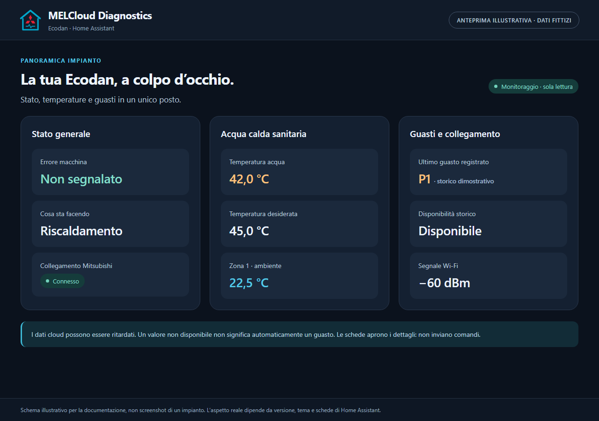
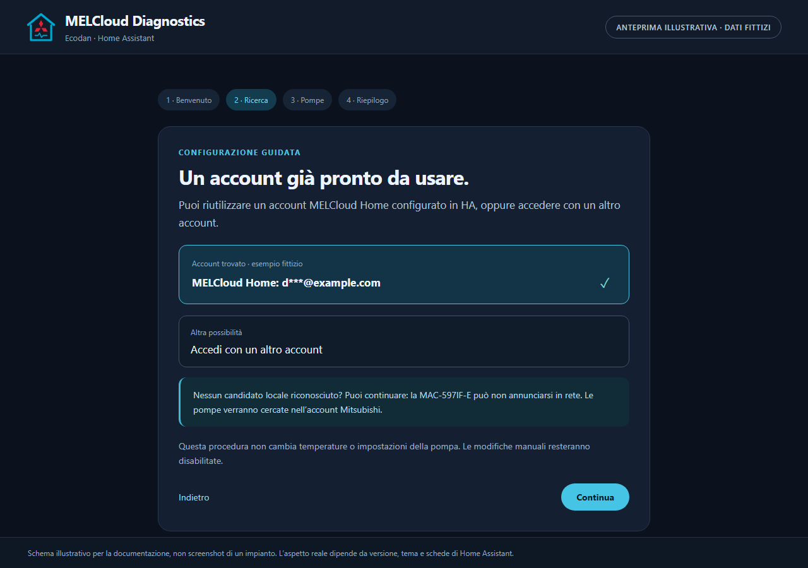
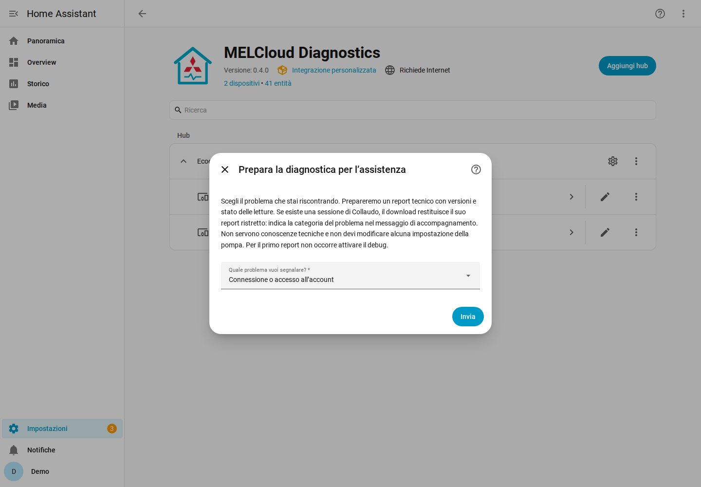

# MELCloud Diagnostics


Diagnostica per Mitsubishi Ecodan in Home Assistant, tramite **MELCloud Home**.
Parte in **sola lettura**. Non richiede hardware aggiuntivo.

**Versione 0.3.0 — release ordinaria, senza collaudo sull’impianto reale.**
Testata con HA Core **2026.10.4**, ultima stabile verificata al 30 ottobre 2026.

## Inizia da qui

- [Aggiornare alla 0.3.0 tramite HACS e ripristinare la versione precedente](docs/RELEASE_030.md).

- [Installazione HACS e prima configurazione guidata](docs/GUIDA_UTENTE.md).
- [Plancia Ecodan: stato, temperature e guasti](docs/GUIDA_UTENTE.md#la-plancia-ecodan).
- [Aggiornamenti, changelog e conservazione dei dati](docs/AGGIORNAMENTI.md).
- [Debug guidato e report per l’assistenza](docs/DEBUG.md).
- [Changelog](CHANGELOG.md) e [release scaricabili](https://github.com/ThatsNotFullAuto/MelCloudHA/releases).
- [Limiti e dettagli tecnici](docs/DETTAGLI_TECNICI.md).

## Installa da HACS

In **HACS → menu ⋮ → Repository personalizzate**, aggiungi:

```text
https://github.com/ThatsNotFullAuto/MelCloudHA
```

Scegli categoria **Integrazione**, scarica **MELCloud Diagnostics** e riavvia
Home Assistant quando richiesto. Poi apri **Impostazioni → Dispositivi e
servizi → Aggiungi integrazione → MELCloud Diagnostics**.

Il wizard cerca account MELCloud Home già presenti in HA, propone il loro
riuso, cerca eventuali candidati locali ESPHome/Asgard e ti fa scegliere le
pompe associate all’account Mitsubishi. Non devi conoscere l’indirizzo IP.
I candidati in rete non sono identificazioni certe della MAC-597IF-E.

## Cosa ottieni

Temperature e impostazioni osservabili, stato operativo, codice guasto,
storico errori quando disponibile, ricorrenze P1, report esportabili e una
plancia nativa adatta a telefono e computer, senza schede aggiuntive.

Le modifiche sono **opzionali e manuali**: permesso separato, riepilogo prima/dopo,
**due conferme**, scadenza e ricontrollo dei valori. Nessun comando dalla plancia,
nessun reset e nessun reinvio automatico dopo un timeout. La mandata resta
esclusa dalle scritture nella prima versione.

## Anteprime

**Immagini illustrative con dati fittizi**, non screenshot di un impianto.
Descrivono le informazioni e i percorsi previsti; l’aspetto reale segue il
tema, le schede e la versione di Home Assistant.



| Configurazione guidata | Assistenza e report |
|---|---|
| [](docs/images/wizard-preview.png) | [](docs/images/support-preview.png) |

Apri un’immagine per vederla più grande. Nessun account o dato reale è mostrato.

## Aggiornamenti

Le release numerate su GitHub alimentano gli aggiornamenti HACS, con changelog
e indicazione del riavvio. Aggiorna l’installazione esistente: non eliminarla e
ricrearla. Entità, credenziali e storico hanno identificativi/formati stabili;
le plance esistenti non vengono sovrascritte. Vedi la [procedura completa](docs/AGGIORNAMENTI.md).

## Progetto indipendente

Non è un’integrazione ufficiale Mitsubishi o Home Assistant. L’icona è un
emblema originale: casa azzurra, richiamo ai tre diamanti e segnale diagnostico;
non riutilizza il logo ufficiale Home Assistant.
Non sono inclusi APK, codice proprietario decompilato, credenziali o dati di un impianto reale.

I test usano risposte sintetiche: disponibilità dei dati e comportamento con
l’account reale vanno ancora verificati. Leggere P1 non ne dimostra la causa.

## Fondamenta FTC4–FTC7 nella 0.3.0

Il modello comune conserva valore, unità, fonte, generazione dichiarata,
disponibilità e timestamp. Il report aggiunge `normalized_telemetry`; le entità,
gli ID e il registro esistenti restano compatibili. Non aggiunge interrogazioni
cloud o comandi. La 0.2.1 resta disponibile come precedente versione stabile.

FTC4, FTC5, FTC6 e FTC7 sono rappresentabili nel modello: questo **non certifica
il trasporto MELCloud Home su ogni generazione**. ESPHome/CN105 e importazione
dei report Mitsubishi hanno soltanto contratti di estensione; nessun adattatore
locale o decoder SD/Bluetooth è operativo. Nessuna prova su impianto reale.

Consulta la [matrice e le fonti](docs/SORGENTI_E_COMPATIBILITA.md), il
[modello tecnico](docs/MODELLO_DIAGNOSTICO.md), la
[guida P1](docs/GUIDA_DIAGNOSTICA.md) e il
[rapporto di questo ciclo](docs/AUDIT_FTC_2026-10-30.md).

Il consolidamento incluso nella 0.3.0 aggiunge persistenza atomica verificata,
recupero dei commit in attesa e test di interruzione. Le notifiche HA restano
senza ricevuta; il registro persistente è la fonte per il recupero degli eventi.
Sono disponibili la [procedura di collaudo cloud](docs/COLLAUDO_MELCLOUD_HOME.md),
il [validatore offline](docs/VALIDAZIONE_DATI_CLOUD.md) e il
[rapporto di affidabilità](docs/AFFIDABILITA_E_COLLAUDO.md). Il collaudo reale
non è stato eseguito e richiederà autorizzazione separata.
