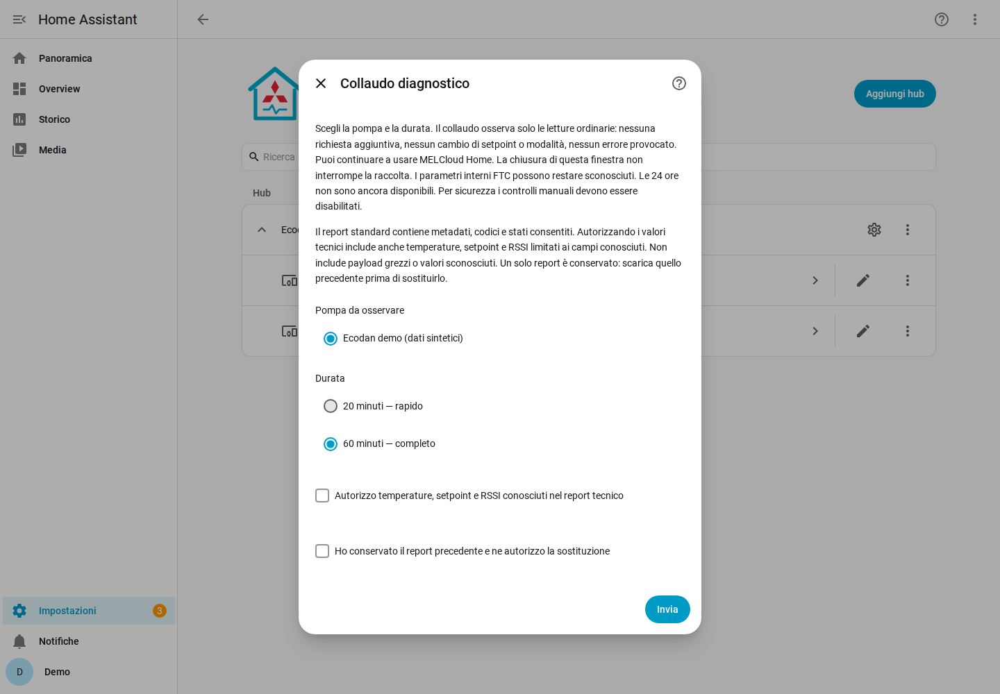
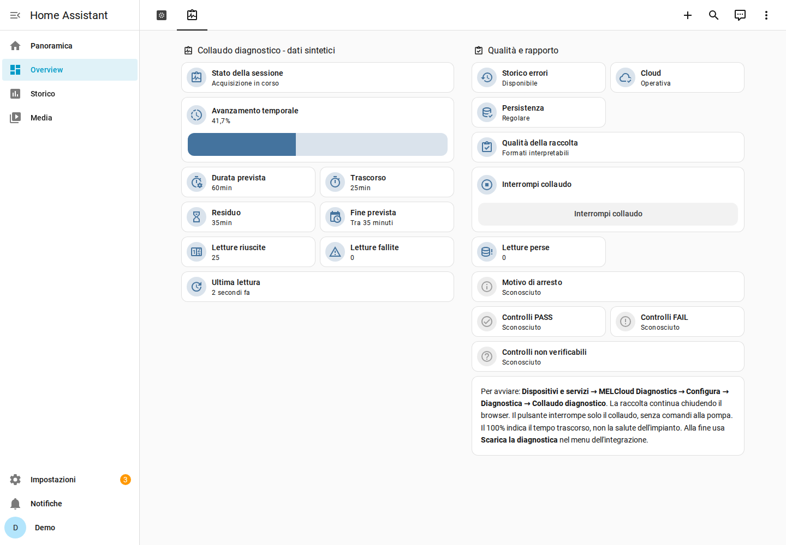

# Collaudo diagnostico guidato — v0.4.0

Disponibile dalla **v0.4.0**, con interfaccia verificata su dati sintetici.
Nessun account Mitsubishi o impianto reale è stato ancora collaudato. La prima
prova deve avvenire su HA isolata e autorizzata prima di valutarne l'uso domestico.
Leggere [requisiti e compatibilità](REQUISITI_E_COMPATIBILITA.md) e
[aggiornamento HACS/ripristino](RELEASE_040.md).

Il collaudo registra le letture ordinarie della sola unità selezionata. Non
modifica la pompa e non aumenta le interrogazioni. È un osservatore software di
richieste attive di lettura cloud, non un monitor elettricamente passivo.
L'account mantiene i privilegi concessi da Mitsubishi: la separazione read-only
è realizzata nel codice, non imposta necessariamente dal server.

## Per chi esegue la prima prova autorizzata

1. Usare prima una **HA di prova isolata**, con backup protetto verificato di
   configurazione, config entry e `.storage/melcloud_diagnostics.<entry_id>`.
   Conservare pacchetto e checksum precedenti. Non avviare una copia completa
   delle automazioni domestiche. Evitare due copie Diagnostics che interrogano
   contemporaneamente lo stesso account.
2. In HACS aggiornare MELCloud Diagnostics a **v0.4.0** e riavviare HA,
   senza sostituire `melcloud_home`. Verificare che le normali entità si aggiornino e che l'app
   Mitsubishi funzioni. Annotare privatamente CPU, RAM, spazio libero e frequenza
   delle letture prima della sessione.
3. Aprire **Impostazioni → Dispositivi e servizi → MELCloud Diagnostics →
   Configura → Diagnostica → Collaudo diagnostico**. I controlli manuali devono
   essere disabilitati. Se sono abilitati, l'avvio viene rifiutato; nessuna opzione
   viene cambiata automaticamente.
4. Scegliere la pompa e **20 minuti** per la prima prova. Il valore predefinito è
   **60 minuti**. Le **24 ore sono disabilitate** finché conservazione e carico
   prolungato non sono validati. Non servono nuove credenziali.
5. Lasciare disattivata l'autorizzazione ai valori tecnici, oppure attivarla
   consapevolmente per includere soltanto temperature, setpoint, limiti di
   capability e RSSI già interpretati. Il report standard conserva disponibilità,
   tipi, conteggi, modalità e codici consentiti, senza questi numeri.
6. Avviare. È ammessa una sola sessione per account/config entry. Per sostituire
   l'unico report precedente occorre conferma esplicita: scaricarlo prima.
7. Aprire il dispositivo **Collaudo diagnostico**, oppure generare la nuova
   plancia da **Configura → Genera plancia**. Nella vista **Diagnostica** compaiono
   barra, percentuale, durata, tempi, scadenza, ultima acquisizione, letture
   riuscite/fallite, stato cloud/storico/storage, osservazioni perse e motivo
   d'arresto. Le dashboard esistenti non vengono sovrascritte: copiare solo la
   nuova vista dal YAML generato, usando gli ID effettivi del registro.
8. Si può chiudere browser o wizard: il task appartiene alla config entry.
   Il menu **Stato del collaudo** mostra una fotografia aggiornata con **Aggiorna
   stato (solo locale)**. Barra e timer della plancia si aggiornano localmente
   ogni 30 secondi, senza mantenere un dialogo HTTP aperto.
9. **Interrompi collaudo** ferma soltanto la raccolta. Le osservazioni già
   accettate vengono elaborate e si salva un risultato `interrotto`. Attendere
   lo stato terminale; nessuna azione viene inviata alla pompa.
10. Al termine leggere esito e controlli PASS/FAIL/non verificabili. Il **100% è
    il tempo trascorso**, non una certificazione dell'impianto. Senza almeno due
    acquisizioni valide l'esito non può essere `completato`. Guasti osservati non
    vengono provocati né cancellati.
11. Facoltativamente usare **Confronto manuale** dopo il termine. Confrontare
    letture già visibili con l'app, tenendo conto di orario, ritardi e distinzione
    aria/acqua. Scegliere coerenti/diversi/non confrontabili/non verificati.
    Non modificare setpoint o modalità. Questa annotazione non cambia il controllo
    automatico di accuratezza fisica, che rimane UNKNOWN.
12. Chiudere il wizard e aprire il menu **⋮ dell'account dell'integrazione →
    Scarica la diagnostica**. Il JSON contiene `data.diagnostic_test`, anche dopo
    stop, chiusura browser e reload. Con una sessione conservata questo download
    restituisce il report ristretto del collaudo, non il precedente report libero
    dell'intero journal. Lo storico ordinario continua a essere conservato.

## Checklist di non interferenza

Prima: backup leggibile; una sola copia Diagnostics; controlli manuali spenti;
normali entità aggiornate; app funzionante; CPU/RAM/disco osservati; eventuale
integrazione ufficiale già funzionante. Annotare l'orario d'inizio.

Durante la prova breve:

- Verificare che aggiornamenti ordinari e altre automazioni continuino con la
  stessa frequenza. Il collaudo non richiama refresh o retry.
- Controllare che non crescano sensibilmente CPU/RAM, scritture disco o dimensione
  Recorder rispetto alla baseline; non esiste una soglia universale qui validata.
- Verificare che MELCloud Home e l'eventuale integrazione ufficiale continuino
  ad aggiornarsi; non cambiare impostazioni per creare variazioni.
- Controllare letture riuscite/fallite, ultimo aggiornamento, persistenza e perdite.
  Se il sistema rallenta, interrompere soltanto il collaudo e conservare il report.
- In presenza di 429 non riavviare ripetutamente sessioni: lasciare al trasporto
  ordinario il suo backoff. Nessun retry aggiuntivo viene introdotto.
- Provare uno stop e un reload **della sola integrazione nella HA di prova**;
  confrontare entità e journal prima/dopo e verificare l'esportazione parziale.

Dopo: scaricare e controllare il report; confrontare il carico con la baseline;
verificare assenza di 429 e continuità dell'app. Valutare solo dopo una prova da
60 minuti. Non abilitare 24 ore. La prova sul sistema domestico ordinario richiede
una valutazione successiva e autorizzazione del proprietario.

## Isolamento e limiti delle risorse

Percorso: GET ordinario → inventario pre-parser di soli metadati limitati →
parsing/persistenza ordinari → copia di fatti normalizzati → coda non bloccante →
worker/executor HA → storage di collaudo separato. Il coordinator non attende
worker, report, UI o storage di collaudo. Il callback sincrono copia soltanto un
insieme limitato di campi: non fa I/O, serializzazione del report o scansioni
ricorsive del payload. I valori sconosciuti non vengono conservati.

| Risorsa | Limite/politica implementata |
|---|---|
| Polling | Invariato: context circa 60 s, storico circa 15 min; nessun GET aggiuntivo |
| Coda | 4 record; `put_nowait`, saturazione conta la perdita e arresta la raccolta |
| Campioni | Massimo 75; nessun uso implicito del Recorder come archivio |
| Eventi e guasti | Massimo 128 per categoria; copia eventi per poll limitata a 32 |
| Inventario | Massimo 128 percorsi complessivi e 128 alias sconosciuti; ispezione sezioni limitata |
| Report | Massimo 1 MiB JSON; file separato con involucro HA fino a 1 MiB + 4096 byte |
| Durate | 20/60 minuti; 24 ore rifiutate anche dal backend |
| UI | Timer locale 30 s; scrittura stato solo quando il valore cambia, nessun evento custom al secondo |
| Disco | Checkpoint per poll elaborato e a transizioni; nessun salvataggio al tick UI |
| Task | Un worker per entry; download contemporanei condividono una elaborazione |
| Lock | Lifecycle solo locale; nessun lock del journal acquisito dal manager/export |
| I/O | Store HA atomico, serializzazione/copie/validazione onerose in executor; attesa salvataggio max 2 s |

Un'ora simulata con una unità produce **64 GET con e senza collaudo**: 60 context
e 4 errorlog. La prima lettura di setup rimane fuori dalla sessione, identica nei
due casi. Ritardi cloud, backoff e più unità possono cambiare i conteggi ordinari:
64 non è una promessa del servizio.

Il test del timer registra tre aggiornamenti stato ogni 30 secondi mentre il
tempo avanza (percentuale, trascorso, residuo), zero a orologio fermo e zero
salvataggi. Gli altri sensori cambiano soltanto con nuovi fatti o transizioni.
Non sono aggiunte statistiche a lungo termine o eventi per ogni osservazione.
Recorder può comunque registrare questi stati. In un'istanza con disco limitato
si possono escludere i soli ID `Collaudo` realmente registrati tramite la
configurazione ufficiale Recorder; il codice non altera le esclusioni utente.

Circuit breaker: 429 e necessità di riautenticazione fermano il collaudo; tre
errori di poll consecutivi, coda piena, limiti di capacità, errori di elaborazione
o persistenza fermano solo il worker. 403/404 dello storico sono rappresentati
come non supportato; non azzerano guasti né invalidano automaticamente i sensori.
La gestione del trasporto ordinario resta indipendente.

Un errore di disco lascia disponibile il report RAM finché HA rimane attivo e
l'ultimo checkpoint confermato su disco. Nessun retry automatico dello storage
del collaudo. Non è possibile garantire la conservazione dei dati RAM dopo un
crash/disco guasto. Un timeout asyncio non può interrompere fisicamente una
operazione OS già in executor; una scrittura atomica potrebbe terminare più tardi.
Non vengono avviati thread o retry senza limiti. La chiusura attende fino a 3 s
il worker, quindi annulla i task e rimuove timer/listener. Dopo riavvio, un
checkpoint ancora attivo diventa `interrotto`, senza ripresa né nuove richieste.

## Conservazione e ripristino

Il journal principale conserva chiave e involucro storage 1, senza migrazione.
La sessione usa `.storage/melcloud_diagnostics.diagnostic_test.<entry_id>`,
involucro HA 1 e report schema 1. L'UUID è necessario **solo nello storage locale**
per associare l'unità e non entra nel report condivisibile. Proteggere i backup.
Si conserva un solo risultato per entry; nessuna pulizia automatica dello storico.

Uno storage di collaudo corrotto viene preservato e disabilita la sola raccolta;
l'integrazione ordinaria continua. Dopo un guasto, esportare prima il risultato
RAM se possibile, fermare la sola integrazione nella HA di prova, conservare una
copia del file danneggiato e ripristinare il suo backup coerente. Non cancellare
il journal principale per riparare un collaudo. In assenza di backup affidabile,
fermarsi e chiedere assistenza, senza reinizializzare automaticamente i dati.

Per ritornare al codice pubblicato 0.3.0: conservare report/backup, interrompere
la sessione, sostituire soltanto il componente con il pacchetto verificato della
release e riavviare la HA di prova. Il file separato del collaudo non è letto da
0.3.0; non occorre convertirlo o eliminare config entry/journal. Non è stato
eseguito un downgrade su HA reale: ripristinare il backup coerente se necessario.

## Contenuto e privacy del rapporto

`format = melcloud_diagnostics.diagnostic_test`, `schema_version = 1`.
Comprende versioni HA/Python/integrazione/libreria, acquisizioni, HTTP osservati,
inventario, parametri decodificati, sequenza temporale, cambi di configurazione,
storico, generazione FTC dichiarata, P1, controlli ed evidenze mancanti.

Solo nomi allowlist sono visibili. Campi sconosciuti hanno alias `field_N`, validi
entro la sessione, con tipi/null/presenza/conteggi; nomi e valori originali non
vengono salvati. Oggetti annidati sconosciuti sono aggregati come oggetto/array,
senza esportarne i figli. Identità e testo libero sono esclusi anche quando un
campo noto contiene stringhe inattese. Nessun payload grezzo, token o header.
La validazione ricorsiva rifiuta chiavi/stringhe inattese prima del salvataggio.

I valori numerici sono esportati solo con consenso iniziale; per i campi numerici
redatti `value = null` e `value_exported = false` non significano dato cloud
assente: leggere `availability` e i conteggi. Le variazioni vengono contate anche
senza esportare i numeri. Sono ancora presenti orari UTC, modalità e codici
diagnostici consentiti: possono rivelare abitudini d'uso. Rivedere prima di condividere.

HA aggiunge un proprio involucro con informazioni sul sistema/software e un nome
file contenente l'ID locale della config entry: questi metadati non sono generati
dal manager. Rinominarlo per la condivisione e rivedere anche l'involucro; il
contratto ristretto riguarda `data.diagnostic_test`. Nessun upload automatico.

Un maintainer può verificare offline il JSON scaricato con
`python -m tools.validate_cloud_data report.json --kind report` e leggerne il
riepilogo con `python -m tools.read_support_report report.json`. Non sono passi
richiesti all'utente per avviare/scaricare il collaudo.

## Come interpretare P1 e le informazioni mancanti

P1 attivo è osservato solo se sono presenti insieme codice P1 e stato errore vero.
Si conservano primo istante di **osservazione** e date dei record storici
interpretati. Lo storico vuoto accessibile non prova assenza di guasti passati.
Non si ricostruiscono valori prima dell'avvio o prima di un guasto non registrato.

Selezione/presenza del sensore ambiente, causa di P1 e completezza dello storico
rimangono UNKNOWN. TH1A/TH1B non vengono attribuiti automaticamente. I candidati
di schema relativi a sensori/firmware sono soltanto nomi da inventariare quando
osservati, non parametri dichiarati accessibili o decoder implementati.

PASS strutturale significa formato interpretabile; PASS temporale significa
timestamp locali di acquisizione ordinati, non dato fisico fresco. La verifica
fisica indipendente resta UNKNOWN. UNKNOWN, UNSUPPORTED e INCONCLUSIVE non sono
guasti. I conteggi per parametro hanno come denominatore le acquisizioni valide
della sessione; i conteggi di presenza schema usano i frame della stessa operazione.

Il report separa campi assenti, presenti non interpretati, formati inattesi,
storico inaccessibile, acquisizioni fallite, parametri FTC non verificabili e
confronti manuali mancanti. Prima si valuta un decoder cloud con evidenze; una
sorgente locale o un report ufficiale si considerano solo per lacune dimostrate.
Non sono integrati Asgard/CN105/SD, né verificata la compatibilità MAC-597IF-E.

Lo stato dello storico può derivare dall'ultimo controllo ordinario precedente
alla sessione: `last_checked_at` e i tentativi riusciti/falliti permettono di
distinguerlo. PASS dello storico richiede almeno una lettura riuscita nella
sessione. Codici non riconoscibili dall'allowlist restano nulli e non vengono
deduplicati come se fossero guasti identici.

## Frontend verificato con dati sintetici

Il generatore usa tile native e `bar-gauge`, senza componenti frontend aggiuntivi.
Riferimenti: [funzionalità dashboard HA](https://www.home-assistant.io/dashboards/features/)
e [flow steps](https://contributors.home-assistant.io/core/integrations/flow-steps/).
Il manager non è un task posseduto da `async_show_progress`.

Il frontend reale HA 2026.10.4 è stato eseguito in un'istanza Linux isolata con
trasporto sintetico. Verificati avvio 20/60 minuti, barra nativa, timer in minuti,
chiusura/riapertura browser, scadenza naturale, stop e download JSON dal menu HA,
anche con errore storage. Desktop 1440×1000 e viewport smartphone 390×844,
temi chiaro/scuro. Non è una verifica su telefono fisico o account Mitsubishi.

La vista ha due sezioni responsive: sessione e tempi; qualità e rapporto.
Se i controlli manuali vengono abilitati durante la raccolta, la sessione si
arresta come parziale con `control_permissions_changed` e FAIL delle condizioni,
prima del reload. Non viene modificata automaticamente l'opzione. Non effettuare
questa prova sul primo impianto reale: mantenerli disabilitati per tutta la prova.

[Completamento](images/diagnostics-collaudo-complete.png),
[stop manuale](images/diagnostics-collaudo-interrupted.png) e
[errore di salvataggio simulato](images/diagnostics-collaudo-partial.png).
Le immagini rappresentano il frontend della 0.4.0 con dati sintetici.
La scadenza visualizzata resta quella programmata anche dopo uno stop anticipato;
il tempo residuo terminale è zero e il motivo d'arresto spiega la conclusione.

Rimangono da verificare costo reale CPU/RAM/disco/Recorder, coesistenza con
automazioni/integrazione ufficiale e disponibilità API sull'account autorizzato.
[Risultati e limiti](VERIFICA_FRONTEND_2026-10-30.md),
[rigenerazione screenshot](SCREENSHOT_COLLAUDO.md).
